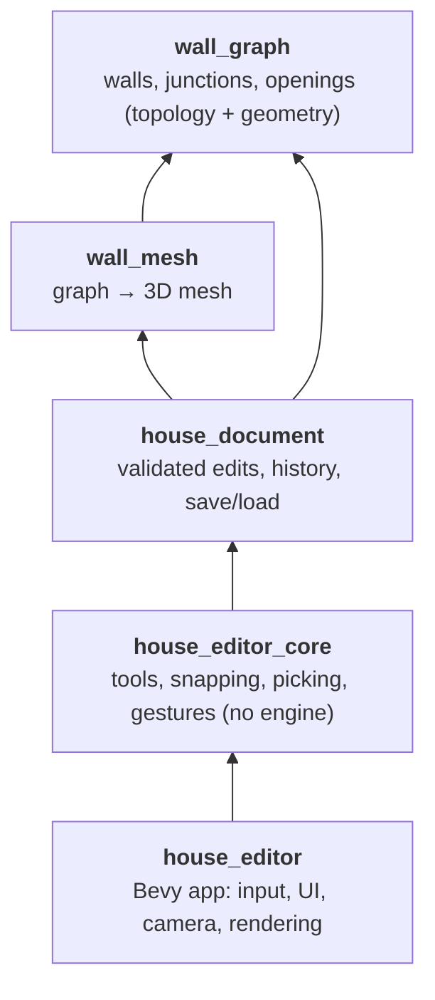
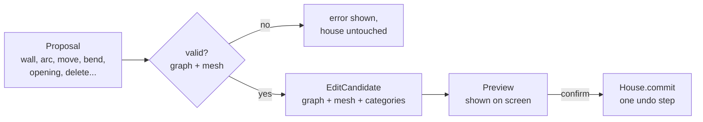
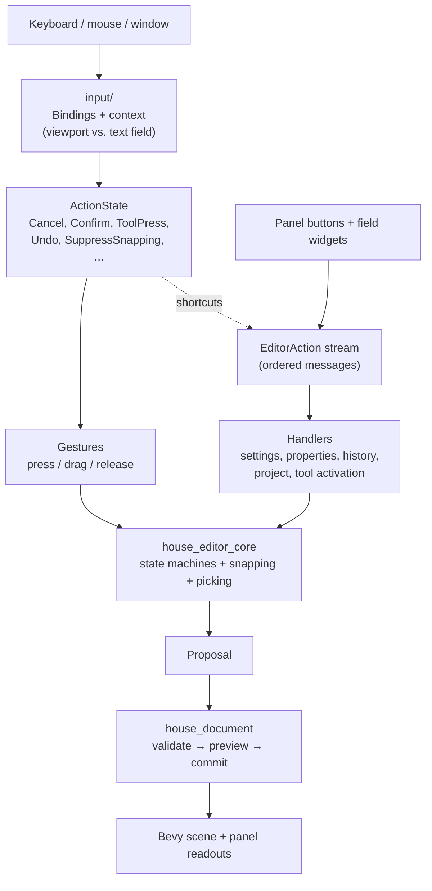
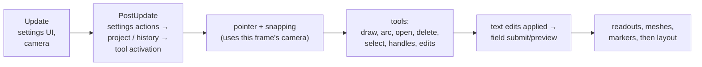
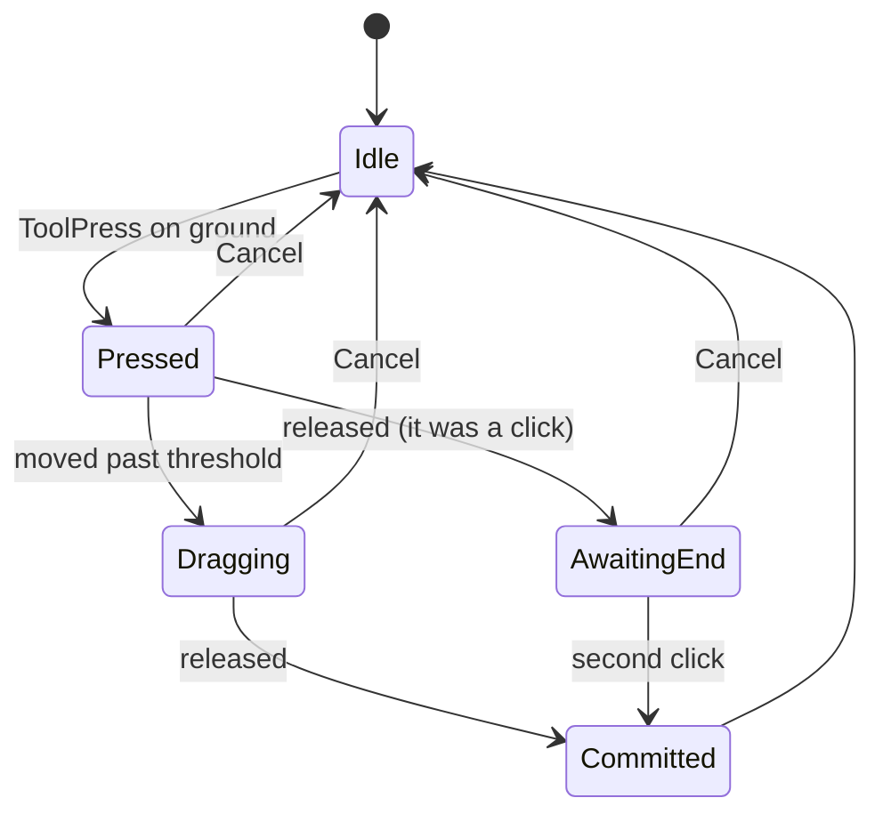

# Architecture overview

A house editor: draw walls and arcs, place doors and windows, edit them, undo, save. The
geometry and editing rules do not depend on Bevy; Bevy is only the shell around them.

## The five crates



An arrow means "depends on". Nothing below `house_editor` knows about Bevy, windows or keys, so
the core can be tested without an app and reused in another host.

| Crate | Owns |
| --- | --- |
| `wall_graph` | The wall graph: nodes, straight and arc walls, openings, tolerances. |
| `wall_mesh` | Turns a graph into a tagged triangle mesh. |
| `house_document` | `House` (committed state + undo/redo + dirty tracking), proposals, the project file format. |
| `house_editor_core` | Semantic `Action`s, snapping, picking, the drawing/drag state machines, project workflow. |
| `house_editor` | Everything engine-specific: devices, panel UI, camera, scene, scheduling. |

## Where to find things

```text
crates/
├── wall_graph/            graph, geometry, tolerances
├── wall_mesh/             mesh generation
├── house_document/src/
│   ├── candidate.rs       proposals + EditCandidate (graph + mesh)
│   ├── document.rs        House: history, dirty tracking
│   ├── opening_category.rs
│   └── project/           file format (file.rs), disk access (io.rs)
├── house_editor_core/src/
│   ├── action.rs          Action, ActionState
│   ├── gestures/          wall_drawing, arc_drawing, handle_drag, opening_drag
│   ├── pointing/          pointer, picking, snapping
│   ├── openings/          area, snap, placement
│   ├── workflow/          preview, selection, project (unsaved-changes), unsaved_changes
│   └── interaction_settings.rs
└── house_editor/src/
    ├── lib.rs, main.rs    plugin + thin binary
    ├── editor_schedule.rs frame ordering
    ├── input/             Bindings → ActionState, on-screen hints
    ├── actions/           EditorAction stream; settings + property actions
    ├── config/            camera + interaction settings resources
    ├── document/          House resource, edit/preview, history, project I/O
    ├── tools/             one module per tool (select, drawing, arc, opening, delete, ...)
    ├── ui/                side panel, field widgets, project bar
    └── viewport/          camera, ground pointer, snapping, coordinates, wall rendering
```

Tests live in `src/tests/`, mirroring this layout.

## The one rule: propose, validate, commit

Every change to the house is a **proposal**. It is checked completely (graph rules *and* mesh
generation) against a copy. Only a valid result can be committed, as one undo step. A failed
edit leaves the house unchanged.



The preview *is* the candidate that gets committed, so what you see is exactly what you get.

## From input to document

Devices and widgets are translated into meaning once, at the edge. Tools never see a key or
mouse button.



Two ways in, on purpose:

- **`ActionState`**: per-frame device state, for gestures (press, drag, release, held keys).
- **`EditorAction` stream**: discrete requests. Handled in the order sent, so an answer can't
  overtake its question. Property edits carry the document revision and are refused if the
  document changed since.

Rebinding a key means editing `Bindings`; no tool changes. On-screen hints (`{Cancel}`,
`{Save}`...) are filled from the same bindings.

## One frame, roughly



The order is set in `editor_schedule.rs`. It matters: a field's Enter must see the text typed
this frame, and the pointer must use the current camera.

## Editing tools

All tools follow the same shape: read `ActionState` + pointer → advance a small state machine
in core → get a proposal → preview → commit on confirm.



(The straight-wall tool; arcs add a "bend" stage, handle and opening drags skip `AwaitingEnd`.)

| Tool | Does |
| --- | --- |
| Select | Hover/select walls and openings; drag handles; delete/duplicate; edit fields. |
| Draw wall | Click twice or drag. |
| Draw arc | Free (ends + bend) or tangent to one/two existing wall ends. |
| Place opening | Door/window on the wall under the pointer, snapped along it. |
| Delete | Click removes what is under the pointer (previewed first). |

## Where state lives

| What | Where |
| --- | --- |
| Committed house, history, saved/dirty | `house_document::House` (Bevy wrapper `document/house.rs`) |
| Preview of the pending edit | `house_editor_core::Preview` |
| Selection, active tool, tool settings | Bevy resources in `house_editor` |
| Drag/draw gesture state | core enums, wrapped as resources |
| Pointer tuning, camera tuning | `InteractionSettings` / `CameraSettings` (validated, with defaults) |
| Unsaved-changes question | `house_editor_core::ProjectWorkflow` (modal while open) |

Core types that must be Bevy resources are wrapped in small `Deref` newtypes, because Rust
does not let `house_editor` implement Bevy's `Resource` for a type from another crate.

## Project files

A versioned, line-based text format in `house_document`. IDs in the file are local; openings
are stored relative to their wall. Opening a bad file never touches the current document.

## Using the editor from another app

```rust
App::new()
    .add_plugins(DefaultPlugins)          // close_when_requested: false
    .add_plugins(HouseEditorPlugin)
    .run();
```

Send `EditorAction`s with `ActionSender`, read `ActionState`, change `Bindings`,
`InteractionConfig` or `CameraSettings` as resources.

## Not done yet

- Key bindings are not saved to disk.
- Some Bevy systems (hover/select, delete tool, placement) are thin wrappers that still live
  in `house_editor`.
- No hands-on smoke test of the finished UI has been run; the automated tests are headless.

More detail and history: `plan/refactor/house-editor-refactor.md`.
